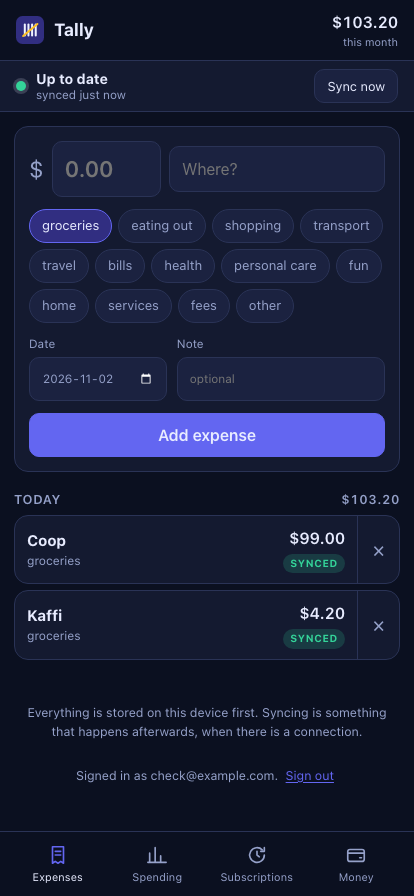

# Tally

An offline-first expense tracker: an installable PWA that keeps working with no
connection, queues writes on the device, and syncs them when the network comes
back. When two devices change the same field of the same entry, a person is
asked which value wins — nothing is silently overwritten.

<p align="center">
  
  
  
</p>

FastAPI + SQLite on the server, React + TypeScript on the device, one
hand-written service worker. An entry is `occurred_on`, `amount_cents`,
`category`, `merchant`, `note` — amounts are integer cents, never floats.

## Running it

Verified on Python 3.14 and Node 24 on Windows. Lower versions probably work
but were not tested; the one hard floor is SQLite 3.35+, for
`UPDATE ... RETURNING`.

```bash
python -m venv .venv
.venv/Scripts/python -m pip install -r backend/requirements-dev.txt   # Windows
# .venv/bin/python -m pip install -r backend/requirements-dev.txt     # macOS / Linux

cd frontend && npm install && npm run build && cd ..

cd backend && ../.venv/Scripts/python -m uvicorn app.main:app --port 8000
```

Then open <http://localhost:8000>.

Build the frontend first — with no `frontend/dist`, `/` returns a 503 telling
you to build rather than an app. Serving the built frontend from the Python
process is deliberate: a service worker only controls pages on its own origin,
so same-origin hosting is what makes the offline shell work at all. Add
`--host 0.0.0.0` to reach it from a phone on the same network, and set
`TALLY_DATABASE_URL` to move the database off its default
(`backend/data/tally.db`).

For frontend work, `npm run dev` serves Vite on :5173 and proxies `/api` to
:8000. It skips the service worker build step, so test install and offline
behaviour against the built app on :8000 instead.

Installing on a real phone needs HTTPS — Chrome only treats plain HTTP as a
secure context on localhost — so put it behind a tunnel (`cloudflared tunnel
--url http://localhost:8000`) or a proxy with a certificate. The queue, the
conflict handling and the offline shell all work fine over plain HTTP.

## Trying the conflict behaviour

Open the **Try the sync behaviour** panel at the bottom of the app. It has a
*Simulate offline* switch plus buttons that make the server act as a second,
already-synced device, so no second phone and no devtools are needed.

- **Conflict:** go offline → edit an amount → *another device edits the amount*
  → go back online. Same field, so you get asked.
- **Auto-merge:** the same, but edit the *note* instead. Different fields, so
  both edits survive and nobody is interrupted.

## How sync works

Nothing writes straight to the server. A tap appends an **op** to an outbox in
IndexedDB, and the UI renders the last server snapshot with the outbox replayed
on top — so a write appears instantly and survives being killed offline. Every
op carries a `base_rev`: *"the newest version of this entry I had seen was N."*

The server answers each op with one of five statuses:

| Status | When | Effect |
| --- | --- | --- |
| `applied` | `base_rev` was current | clean fast-forward |
| `merged` | stale, but you and the server touched **different** fields | both edits kept |
| `conflict` | stale **and** the same field, or delete vs. edit | nothing applied, both versions returned |
| `invalid` | unknown entry or a bad field value | rejected |
| `blocked` | an earlier op in the same batch conflicted | deferred until that one is resolved |

`merged` is possible because the server keeps an append-only log of which
fields changed at which revision (`entry_changes`), so given your `base_rev` it
can intersect what moved while you were away with what you changed. Conflicts
are parked in a local `conflicts` store and shown as a card with both values;
resolving builds a fresh op against the revision the server *actually* holds,
so it lands first try.

Retries are idempotent: every result, conflicts included, is stored per `op_id`
in `applied_ops` and replayed, so a push whose response got lost does not apply
twice. The outbox is compacted before each push — repeated edits to one entry
collapse into one op, and an entry created *and* deleted while offline is never
sent at all. Deletes are tombstones with revisions, so a deletion propagates
instead of the entry reappearing on the next pull.

## Layout

```
backend/
  app/sync.py        the protocol: conflict detection, merging, cursors
  app/models.py      entries, per-revision change log, idempotency ledger
  app/schemas.py     field schema and patch validation
  app/main.py        endpoints + static hosting for the built PWA
  tests/             protocol tests and two-device narratives
frontend/
  public/sw.js       the service worker (~150 lines, no Workbox)
  scripts/           post-build service worker stamping
  src/lib/           sync engine, outbox compaction, IndexedDB, transport
  src/components/    sync bar, entry list, conflict cards, install banner
tools/
  make_icons.py      PNG icon generation using only the stdlib
  smoke_test.py      HTTP-level end-to-end checks
  browser_check.mjs  real-Chromium checks
  check_all.py       run everything
```

## Tests

```bash
python tools/check_all.py      # everything below, in order
```

| Suite | Count | Covers |
| --- | --- | --- |
| `cd backend && pytest` | 27 | the protocol, every conflict path, idempotency, two-device stories |
| `cd frontend && npm test` | 39 | the client engine: queueing, restart durability, lost responses, compaction, resolution |
| `python tools/smoke_test.py` | 34 | a real uvicorn process over HTTP: app shell, SPA fallback, SW and manifest headers, asset caching, push/pull |
| `node tools/browser_check.mjs` | 34 | real Chromium: SW install, installability, offline cold start, conflict resolution end to end |

All four pass; the counts are from an actual run, not aspirations. The browser
check starts its own server, writes an expense with the network off, reloads
*while still offline*, reconnects, watches the queue drain, then drives a
conflict through to resolution — and produces the screenshots above. It needs
Chromium (`cd frontend && npx playwright install chromium`); `check_all.py`
skips it if Playwright is absent.

## Surprising things

- **The sync protocol is implemented twice.** The vitest suite drives the
  engine against a `MemoryStore` and `src/lib/testing/fakeServer.ts`, ~400
  lines that reimplement the Python conflict rules in TypeScript. It makes the
  client testable in plain Node, but the two can drift, and nothing but
  `smoke_test.py` and `browser_check.mjs` would notice. It also means
  **IndexedDB, the real HTTP transport and the service worker are not covered
  by the unit tests at all** — only by the browser check.
- **`/api/demo/*` is open, unauthenticated, and writes to the live database.**
  It exists so the conflict UI can be demonstrated from one browser. Remove it
  or gate it behind a flag before this goes anywhere real. CORS is `*` too.
- **`server_notes` is dead code.** `models.py` declares a `ServerNote` table
  whose docstring claims the demo endpoints and health checks use it. Nothing
  references it; the table is created and stays empty.
- **`navigator.onLine` is treated as a hint, not proof** — it reads true on a
  captive portal. Being offline is a UI state; only a server actually refusing
  is an error. Pushes are triggered by the `online` event, tab visibility, a
  30-second interval, and a Background Sync nudge.
- **Background Sync only wakes a live page.** The push logic lives in the page,
  not the worker, so with no client alive the queue waits for the app to be
  opened. Chromium-only; elsewhere the three triggers above cover it.
- **The service worker is stamped after the build.** Vite copies `public/sw.js`
  through untouched, then `scripts/finalize-sw.mjs` fills in the precache
  manifest and a version hashed from `dist`, so an identical rebuild does not
  invalidate every client's cache. It throws if run twice on the same output.
- **Compaction discards intermediate history.** Ten offline edits to one amount
  arrive as one op: current intent survives, keystrokes do not.
- **Conflicts are per field, not per character.** Two people editing the same
  note get asked which note they want; there is no three-way text merge.

## Limits

Decisions made without being able to ask, and what a real deployment would need
next:

- **No accounts.** Every device syncs the same single ledger. Adding auth means
  a user id on `entries` and a filter on pull; the conflict machinery is
  unaffected.
- **SQLite.** Fine for one household. The only Postgres-specific change would
  be swapping the sequence counter's `UPDATE ... RETURNING`.
- **Nothing is ever purged.** Tombstones and the `entry_changes` and
  `applied_ops` logs grow forever — fine at household scale, but not a
  retention policy. Pull is a cursor scan over `entries`, 200 rows a page
  (max 500).
- **The expense domain is a thin layer.** The sync machinery is field-generic:
  bodies are JSON validated against one schema (`backend/app/schemas.py`,
  `frontend/src/lib/fields.ts`), so swapping expenses for workouts means
  editing that schema, not the protocol.
