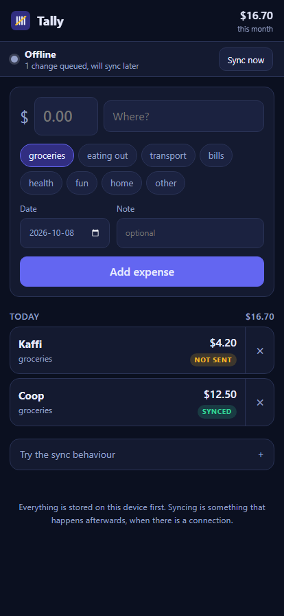
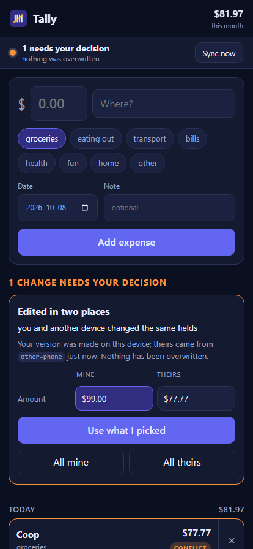

# Tally

An installable PWA for tracking expenses on a phone, built offline-first. Writes
are saved on the device and queue up with no connection; when the network comes
back they sync, and when two devices disagree about the same field **a person
decides** — nothing is silently overwritten.

<p align="center">
  
  
  
</p>

Python (FastAPI + SQLite) on the server, React + TypeScript on the device.

---

## Running it

You need Python 3.11+ and Node 18+.

```bash
# 1. backend
python -m venv .venv
.venv/Scripts/python -m pip install -r backend/requirements-dev.txt   # Windows
# .venv/bin/python -m pip install -r backend/requirements-dev.txt     # macOS / Linux

# 2. frontend
cd frontend
npm install
npm run build          # typechecks, bundles, and stamps the service worker
cd ..

# 3. serve
cd backend
../.venv/Scripts/python -m uvicorn app.main:app --host 0.0.0.0 --port 8000
```

Then open <http://localhost:8000>.

Serving the built frontend from the Python process is deliberate: a service
worker only controls pages on its own origin, so same-origin hosting is what
makes the installed app and its offline shell work at all. `--host 0.0.0.0` lets
you open it on your actual phone at `http://<your-laptop-ip>:8000`.

> **Installing on a real phone.** Chrome and Android will offer to install over
> plain HTTP on `localhost` only. From another device you need HTTPS, so put it
> behind a tunnel (`cloudflared tunnel --url http://localhost:8000`, `ngrok http
> 8000`) or a reverse proxy with a certificate. Everything else — the queue, the
> conflict handling, the offline shell — works over plain HTTP on localhost.

### Development

```bash
cd backend && ../.venv/Scripts/python -m uvicorn app.main:app --reload --port 8000
cd frontend && npm run dev     # Vite on :5173, proxying /api to :8000
```

The dev server does not run the service worker build step, so test install and
offline behaviour against the built app on port 8000.

### Regenerating the icons

```bash
python tools/make_icons.py
```

Pure standard library — a small PNG writer over `zlib` — so there is no image
dependency to install.

---

## What it tracks

Expenses: amount, date, category, merchant, note. The domain was a free choice
(the brief said "something I track on my phone"); expenses were picked because
they are genuinely logged on a phone, often with no signal, and because the same
record plausibly gets edited from two places — which is what makes conflict
handling worth building rather than hypothetical.

The sync machinery underneath is field-generic. Entry bodies are a JSON blob
validated against one field schema (`backend/app/schemas.py`,
`frontend/src/lib/fields.ts`), so swapping expenses for workouts or readings
means editing that schema, not the protocol.

---

## How the sync works

### The shape of a write

Nothing ever writes straight to the server. A tap appends an **op** to an outbox
in IndexedDB and returns:

```
{ op_id, entry_id, kind: create|update|delete|restore, base_rev, fields, client_ts }
```

`base_rev` is the claim that matters: *"I am changing this entry, and the newest
version I had seen was revision N."*

What the UI renders is the last server snapshot with the outbox replayed on top
(`materialize()`). That is why a write appears instantly and survives being
killed on a plane — the network is a separate, slower story.

### What the server does with it

Each op resolves to exactly one of four outcomes:

| Status | When | Effect |
| --- | --- | --- |
| `applied` | `base_rev` matched | clean fast-forward |
| `merged` | stale, but you and the server changed **different** fields | both edits kept |
| `conflict` | stale **and** the same field, or delete vs. edit | **nothing applied**, both versions returned |
| `invalid` | unknown entry or bad field value | rejected, surfaced to the user |

The merge/conflict distinction is possible because the server keeps an
append-only log of *which fields changed at each revision*
(`entry_changes`). Given your `base_rev` it can work out exactly what moved
while you were away and intersect that with what you changed.

So: you fix the amount while your partner adds a note → both survive, no
interruption. You both retype the amount → you get asked.

A last-write-wins server would accept every one of those cases and quietly
destroy whichever edit lost the race.

### Conflicts are a UI state, not an error

A conflict parks the op in a `conflicts` store and shows a card with both
versions side by side, labelled by the device that produced each. You can resolve
per field, take all of yours, take all of theirs, or for delete races choose
*bring it back with my edits* / *accept the deletion*.

Resolving builds a fresh op based on the revision the server **actually holds**,
so it lands first time instead of bouncing off the same stale `base_rev` again.
If the entry moves again while the card is still open, the card re-points itself
at the new version rather than letting you decide against something superseded.

### The things that bite in practice

- **Lost responses.** A push that lands but whose response never arrives gets
  retried with the same `op_id`. The server keeps an idempotency ledger
  (`applied_ops`) and replays the stored result, so the write is not duplicated.
  Conflicts are recorded there too — a retried op gets the same answer rather
  than being re-judged against a target that has since moved.
- **A week of offline edits.** The outbox is compacted before each push: edits to
  one entry collapse into a single op, and an entry created *and* deleted before
  any sync annihilates and is never sent at all. Compaction is persisted before
  the push so retries reuse the same `op_id`.
- **Chained offline edits.** Several queued ops for one entry all carry the same
  `base_rev`, because nothing bumps a revision until the server sees it. The
  server tracks the revision a batch *started* from, so an op is not treated as
  stale against a revision its own predecessor just created.
- **`navigator.onLine` lies.** It goes true for a captive portal or a Wi-Fi
  network with no route out. It is treated as a prompt to try, never as proof —
  the real signal is whether a push succeeds. Being offline sets a *state*, not
  an error; only a server actually saying no is a failure.
- **Tombstones.** Deletes are tombstones with revisions, so a deletion
  propagates to other devices instead of the entry quietly reappearing on the
  next pull.

### Pulling

`GET /api/sync/pull?since=<cursor>` returns everything with a `server_seq`
greater than the cursor, tombstones included. The sequence comes from a single
atomic counter (`UPDATE ... RETURNING`), so a gap or a reuse can't make a device
silently miss a change.

---

## The PWA parts

**Install prompt.** `beforeinstallprompt` is captured and suppressed so the app
can offer installation at a sensible moment rather than the browser picking one.
iOS Safari fires no such event, so it is detected and shown the real
Share → Add to Home Screen steps instead of a button that would do nothing.

**Offline shell.** A hand-written service worker (`frontend/public/sw.js` — ~150
readable lines, no Workbox):

- navigations are served **cache-first** from the precached shell, then
  revalidated in the background, so a cold start with no signal is instant;
- `/api/*` is never touched — writes are the app's job, and a cached sync
  response would be actively harmful;
- other same-origin GETs are stale-while-revalidate;
- `scripts/finalize-sw.mjs` stamps the precache manifest and a version hashed
  from the built output after each build, so a deploy invalidates exactly once
  and never by accident;
- a waiting worker is surfaced as a *reload* prompt rather than swapped in
  underneath someone mid-entry.

**Storage.** IndexedDB, not localStorage — localStorage is synchronous,
string-only, and the first thing evicted under storage pressure. The app also
calls `navigator.storage.persist()`, because losing a week of unsynced entries to
a storage sweep would be worse than having no tracker.

---

## Trying the conflict behaviour

Open the **Try the sync behaviour** panel at the bottom of the app. It has a
*Simulate offline* switch and buttons that make the server act as a second,
already-synced device — no second phone and no devtools needed.

- **Make a conflict:** turn on *Simulate offline* → edit an expense's amount →
  press *another device edits the amount* → turn offline back off. You both
  changed the amount, so you get asked.
- **Watch an auto-merge:** same thing, but edit the *note* instead. Nothing
  overlaps, so both edits survive and no one is interrupted.
- **Delete race:** offline, delete an expense, then *another device adds a note*,
  then come back online.

---

## Verifying it

```bash
python tools/check_all.py      # everything below, in order
```

| Suite | Count | Covers |
| --- | --- | --- |
| `cd backend && pytest` | 27 | sync protocol, every conflict path, idempotency, and end-to-end two-device stories |
| `cd frontend && npm test` | 39 | client engine against a fake server: queueing, restart durability, lost responses, compaction, resolution |
| `python tools/smoke_test.py` | 34 | a real uvicorn process over HTTP: app shell, SPA fallback, service worker headers, manifest, icon bytes, asset caching, push/pull with a conflict and a merge |
| `node tools/browser_check.mjs` | 34 | a real Chromium |

The browser check is the one that proves the headline claims. It installs the
service worker, confirms Chrome parses the manifest as installable, writes an
expense with the network switched off, **reloads the page while still offline**
and watches the app open from cache with the unsent write intact, reconnects and
watches the queue drain, then drives a full conflict through to resolution and
confirms the chosen value is what the server ends up holding. The screenshots at
the top of this README are produced by that run.

It needs Chromium:

```bash
cd frontend && npm install && npx playwright install chromium
npm run test:browser
```

---

## Layout

```
backend/
  app/sync.py        the protocol: conflict detection, merging, cursors
  app/models.py      entries, the per-revision change log, idempotency ledger
  app/schemas.py     the entry field schema and validation
  app/main.py        endpoints + static hosting for the built PWA
  tests/             protocol tests and two-device narratives
frontend/
  public/sw.js       the service worker
  scripts/           post-build service worker stamping
  src/lib/           sync engine, outbox compaction, IndexedDB, transport
  src/components/    sync bar, entry list, conflict cards, install banner
tools/
  make_icons.py      stdlib PNG icon generation
  smoke_test.py      HTTP-level end-to-end checks
  browser_check.mjs  real-browser checks
  check_all.py       run everything
```

---

## Assumptions and limits

Decisions made without being able to ask, and the things a real deployment would
need next:

- **Single user, no accounts.** Every device syncs the same ledger. Adding auth
  means a user id on `entries` and a filter on pull; the conflict machinery does
  not change.
- **SQLite.** Fine for one household. The only Postgres-specific change would be
  swapping the counter's `UPDATE ... RETURNING` for a sequence.
- **Compaction loses intermediate history.** Ten offline edits to one amount
  arrive as one. The user's current intent is preserved; the keystrokes are not.
- **Background Sync is a nudge, not a guarantee.** The worker wakes live clients
  when connectivity returns, but the push logic lives in the page, so with no
  client alive the queue waits for the app to be opened. That is correct, just
  less immediate. Chromium-only; elsewhere the app's own online, visibility and
  30-second interval triggers cover it.
- **Demo endpoints are open.** `/api/demo/*` exists so the conflict behaviour can
  be shown from one browser. Remove it, or gate it behind a flag, before putting
  this anywhere real.
- **Conflicts are per field, not per character.** Two people editing the same
  note get asked which note they want; there is no three-way text merge.
